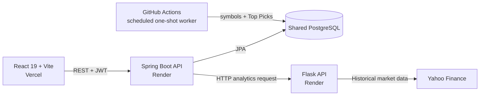

# OptiWealth architecture

OptiWealth separates browser presentation, authenticated application APIs, quantitative analytics, and scheduled market-data refresh. The frontend is hosted on Vercel; the Spring Boot and Python services are deployed as separate Render services. Both backend services use the same PostgreSQL database.

## Components and deployment boundaries

### React frontend

The Vite application provides registration and login, protected dashboard and portfolio views, holdings management, symbol search, Top Picks, and portfolio analytics. Axios uses `VITE_API_BASE_URL` to target Spring Boot and attaches the user's JWT as an `Authorization: Bearer` header. The default local API URL is `http://localhost:8080`.

React Router uses browser history; `frontend-react/vercel.json` rewrites application routes to `index.html` so deep links work on Vercel. The browser communicates with Spring Boot only. It must not receive database credentials or call a private Python endpoint.

### Spring Boot API

Spring Boot 3 / Java 17 provides JWT authentication, portfolio and holding CRUD, database-backed symbol search, Top Picks access, and analytics orchestration. It reads its datasource, JWT signing key, Python base URL, frontend CORS origin, and HTTP port from environment-backed properties in `application.properties`.

The authenticated frontend API includes:

- `POST /auth/register` and `POST /auth/login`
- `/api/portfolios` and related holding endpoints
- `GET /api/symbols?query=...`
- `GET /api/top-picks`
- `GET /api/analytics/{portfolioId}/analyze`
- `GET /health` for service health

Spring Security configures CORS in `SecurityConfig`. It allows local development origins and the exact `FRONTEND_ORIGIN`, with the methods and headers used by the app. Credentialed CORS does not use a wildcard origin.

### Python analytics service

Flask exposes `GET /` and `GET /health` health responses and `POST /analyze-portfolio` for analytics. Gunicorn starts `controller:app` in the Render Docker image. Quantitative modules gather Yahoo Finance data and produce descriptive metrics, risk metrics, forecasts, portfolio optimization, and a structured report. Gemini-generated narrative output is optional and uses `GOOGLE_API_KEY` on the server only.

The Python symbol catalog and Top Picks modules also connect directly to PostgreSQL using `DB_HOST`, `DB_PORT`, `DB_NAME`, `DB_USER`, and `DB_PASSWORD`.

### Scheduled refresh worker

`symbol_refresh_worker.py` contains the shared refresh operation. The `--once` option refreshes the symbol catalog and Top Picks once, then exits with a success or failure status. GitHub Actions uses that mode on its schedule, on pushes to `main`, and for manual runs; workflow concurrency prevents overlapping executions.

Without `--once`, the same script performs an initial refresh and starts APScheduler for daily 02:00 refreshes. This mode is intended for local use. Do not run it as an additional Render scheduler while GitHub Actions is refreshing the same database.

## Data flows

### Authentication and portfolio requests

The browser submits registration or login credentials to Spring Boot. Login returns a JWT, which the Axios client attaches to subsequent authenticated requests. Spring Boot verifies ownership of portfolios and persists user, portfolio, and holding data through Spring Data JPA.

### Portfolio analysis

1. The frontend requests `GET /api/analytics/{portfolioId}/analyze` with the user's JWT.
2. Spring Boot verifies the authenticated user's portfolio ownership and gathers its holdings.
3. Spring Boot sends the holdings to Python at `POST /analyze-portfolio`.
4. Python downloads market history and generates the quantitative report, with Gemini narrative generation when configured.
5. Spring Boot returns the report to the frontend as the original HTTP response.

This is a synchronous request/response flow. There is no server-side job queue or durable analysis-status endpoint. The frontend caches a completed report in `sessionStorage`; this is browser-session caching, not persisted server-side analysis state.

### Symbols and Top Picks

The scheduled Python worker downloads the NSE symbol catalog and writes it to `symbols`. It then fetches market data and updates the `top_picks` table. Spring Boot reads those tables for symbol validation/search and Top Picks endpoints. Failed catalog refreshes do not replace the active catalog with an incomplete download.

## PostgreSQL ownership and tables

Spring Boot uses JPA/Hibernate to manage application users, portfolios, and holdings. The Python worker accesses `symbols` and `top_picks` directly with psycopg2. Both services must point to the same PostgreSQL database; configuring separate databases leaves symbol search, holding validation, or Top Picks out of sync.

The current Hibernate setting is `spring.jpa.hibernate.ddl-auto=update`. There is no migration framework in the repository. Do not switch databases or apply destructive schema changes as part of routine deployment.

## Configuration boundaries

| Configuration | Consumer | Purpose |
| --- | --- | --- |
| `VITE_API_BASE_URL` | Vercel build | Public Spring Boot API base URL |
| `SPRING_DATASOURCE_URL`, `SPRING_DATASOURCE_USERNAME`, `SPRING_DATASOURCE_PASSWORD` | Spring Boot | JDBC connection to the shared PostgreSQL database |
| `JWT_SECRET` | Spring Boot | JWT signing; must be generated and stored as a secret |
| `PYTHON_SERVICE_URL` | Spring Boot | Flask base URL; Spring appends `/analyze-portfolio` |
| `FRONTEND_ORIGIN` | Spring Boot | Exact Vercel origin permitted by CORS |
| `DB_HOST`, `DB_PORT`, `DB_NAME`, `DB_USER`, `DB_PASSWORD` | Python service and refresh worker | psycopg2 connection to the same PostgreSQL database |
| `GOOGLE_API_KEY` | Python service | Optional Gemini summaries |
| `PORT` | Render web services | HTTP listener port; local defaults are 8080 for Spring and 8000 for Flask |

Never put database credentials, JWT signing keys, or Gemini API keys in the frontend build environment. Local setup and Render/Vercel configuration are documented in [RUNNING.md](RUNNING.md).

## Operational constraints

- Spring Boot must be able to reach the configured Python service URL. Use the Render private address only when the Python service can accept private-network requests; otherwise use its public HTTPS service URL.
- Keep the Spring Boot API, Python service, and database on compatible network paths and point both backend services at the same database.
- Market-data requests depend on the external provider and may take time. Analytics remain synchronous until an asynchronous server-side job mechanism is implemented.
- Run a single scheduled refresh per database. GitHub Actions is the configured production scheduler.
- API health checks are `GET /health` for Spring Boot and `GET /health` (also `/`) for Flask.
