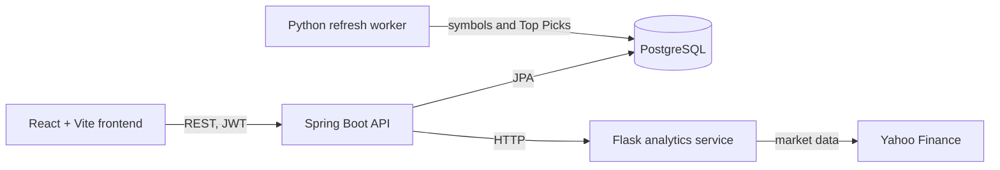

# OptiWealth

OptiWealth is a portfolio management and analytics application. It combines a React frontend, a Spring Boot API, a Python analytics service, and PostgreSQL storage.

## Capabilities

- JWT-based account registration and login
- Portfolio and holdings management
- Symbol search backed by a refreshed NSE symbol catalog
- Portfolio performance, risk, forecasting, and optimization analytics
- Top Picks generated by the scheduled Python worker
- Optional investment summaries through Google Gemini

## Architecture



The browser communicates with Spring Boot only. Spring Boot handles authentication, portfolio operations, and analytics requests. It forwards analysis requests to Flask, which gathers market data and computes the analytics response. Spring Boot and the Python refresh worker use the same PostgreSQL database; configure both against the same database instance.

Portfolio analysis currently follows a request/response flow: the frontend calls `GET /api/analytics/{portfolioId}/analyze`, Spring Boot calls Python's `POST /analyze-portfolio`, and the result is returned to the frontend. The browser should use the Spring Boot API URL; it should not connect directly to PostgreSQL or to a private Python service.

## Technology

| Component | Technologies |
| --- | --- |
| Frontend | React 19, TypeScript, Vite, React Router, Axios |
| API | Java 17, Spring Boot 3, Spring Security, Spring Data JPA |
| Analytics | Python, Flask, pandas, NumPy, statsmodels, arch, yfinance |
| Storage | PostgreSQL |
| AI summaries | Google Gemini through `google-genai` (optional) |

## Local development

Install the prerequisites listed in [RUNNING.md](RUNNING.md), provision a local PostgreSQL database, and configure the service environment variables described there. In particular, Spring Boot requires a local `JWT_SECRET`; Python database access requires `DB_HOST`, `DB_PORT`, `DB_NAME`, `DB_USER`, and `DB_PASSWORD`. `GOOGLE_API_KEY` is optional.

Run each service from its own directory:

```bash
# Terminal 1: Python analytics service (microservice-python/)
python -m venv .venv
python -m pip install -r requirements.txt
python controller.py

# Terminal 2: Spring Boot API (backend-springboot/)
./mvnw spring-boot:run

# Terminal 3: frontend (frontend-react/)
npm install
npm run dev
```

On Windows, use `mvnw.cmd spring-boot:run` from `backend-springboot/`. The frontend defaults to `http://localhost:8080` for the backend. Set `VITE_API_BASE_URL` when using a different API URL. The Python service defaults to port `8000`; the Spring Boot API defaults to `8080`.

The symbol and Top Picks refresh can be run once with `python symbol_refresh_worker.py --once`, or continuously with `python symbol_refresh_worker.py`. The continuous worker performs an initial refresh and schedules the daily refresh at 02:00. For hosted scheduled refreshes, the repository's GitHub Actions workflow runs the one-shot command and prevents overlapping runs. Run only one continuous scheduler per database if using the continuous worker. Workflow setup and required secrets are covered in [RUNNING.md](RUNNING.md).

## Deployment

The current deployment uses Vercel for the frontend and Render for the Spring Boot and Python services. Configure PostgreSQL separately, then point both backend services at the same database. Set the required service variables in the respective hosting dashboards.

- Vercel frontend root: `frontend-react/`; build command `npm run build`; output directory `dist`.
- Render Spring Boot root: `backend-springboot/`; use the Dockerfile in that directory.
- Render Python analytics root: `microservice-python/`; Gunicorn serves `controller:app` from its Dockerfile.
- GitHub Actions runs the scheduled symbol catalog and Top Picks refresh using `python symbol_refresh_worker.py --once`.

Set `VITE_API_BASE_URL` in Vercel to the public Spring Boot URL. Configure `FRONTEND_ORIGIN` and the service/database variables in Render. Do not put database credentials, JWT signing secrets, or Gemini credentials in frontend variables.

## Verification

See [RUNNING.md](RUNNING.md) for local environment setup and smoke-check commands. The frontend scripts include `npm run build` and `npm run lint`; the Spring Boot Maven wrapper supports `test` and `package`.

## License

See [LICENSE](LICENSE) for the project license.
